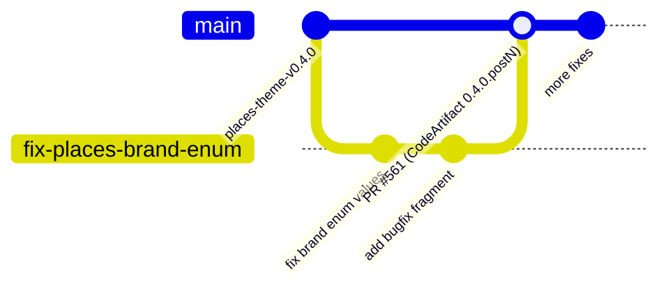
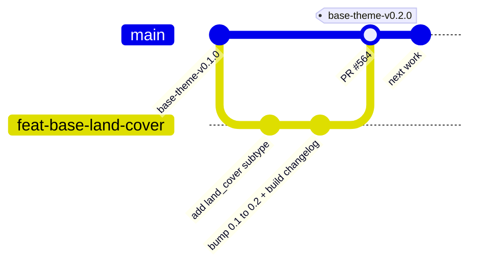
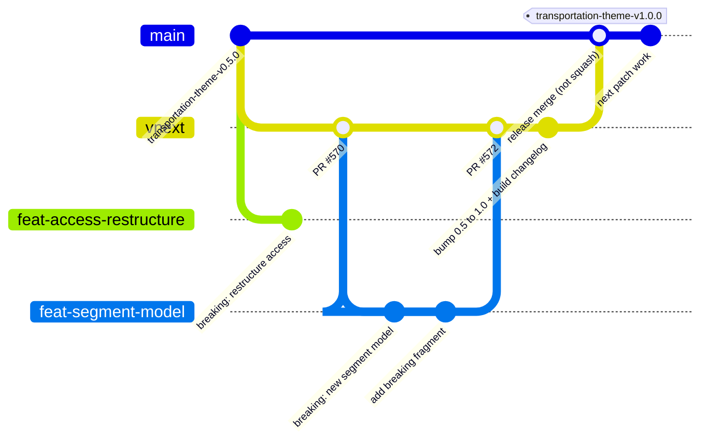

# Contributing to Overture Schema

Read this guide if you're on Overture staff or at a member organization and you're
changing the schema repository. Use it to set up a clone, follow the conventions for
Overture's themes, run the tests and checks, choose a target branch, version a package,
and open a pull request. To learn how to write Pydantic models, see
[Writing models](guides/writing-models.md).

## Set up a clone

```bash
git clone https://github.com/OvertureMaps/schema.git
cd schema
uv sync --all-packages
```

`uv sync --all-packages` creates a `.venv/` folder at the repo root and installs all
thirteen packages into it from `packages/`. Edits you make under `packages/` take effect
without reinstalling. Run commands from the repo root. Every command in
[the schema guides](guides/README.md) works in a clone, and the sample files are already in
`guides/examples/`.

```
schema/
├── .venv/                    ← created by uv; all thirteen packages live here
│   └── bin/
│       ├── overture-schema     ← the three commands land here
│       ├── overture-codegen
│       └── overture-validate
├── packages/
└── pyproject.toml
```

Your clone has the code on the branch you checked out, which can be newer than the latest
PyPI release. To see which version you have, run `uv run overture-schema --version`.

### Generate the PySpark expressions

The PySpark validation expressions are generated code, and they aren't committed to git.
They're listed in `.gitignore`, so `uv sync` alone doesn't create them. If you work on
`overture-schema-pyspark` or run the full test suite, generate them:

```bash
make generate-pyspark
```

`make generate-pyspark` first runs `uv sync --all-packages --all-extras`, which installs
PySpark through the `spark` extra, and then writes the expressions. It prints nothing when
it succeeds. `make install` does the same two things. If `model_names()` later returns an
empty list, see
[that entry in Troubleshooting](guides/troubleshooting.md#model_names-returns--or-keyerror-on-a-feature-type).

The published wheels already include the generated expressions, so people who install from
PyPI never run this step. For the reasons, see
[Generated code and git](guides/concepts.md#generated-code-and-git).

### Develop against a local clone

If you're changing the schema and your own application at the same time, point `uv` at
the package directories in your clone instead of PyPI:

```toml
# myapp/pyproject.toml
[tool.uv.sources]
overture-schema-theme-buildings = { path = "/path/to/schema/packages/overture-schema-theme-buildings", editable = true }
overture-schema-cli             = { path = "/path/to/schema/packages/overture-schema-cli",             editable = true }
```

Then run `uv sync`. With `editable = true`, edits in your schema clone take effect in
`myapp` right away. To go back to PyPI, delete the `[tool.uv.sources]` block.

## Tests and checks

```bash
# Run the tests affected by your changes, plus type and code quality checks
make check

# Run every test, whatever changed
make test-all

# Run tests for a specific package
uv run pytest packages/overture-schema-theme-buildings/

# Run tests matching a pattern
uv run pytest -k "buildings"
```

`make check` regenerates the PySpark expressions before it runs the tests.

When you run `make check` or `make test`, you run only the tests whose code has changed
since they last passed. [pytest-testmon](https://testmon.org/) makes that selection and
keeps its record in `.testmondata`. The record doesn't depend on git, so an uncommitted
edit that an earlier run already tested counts as unchanged. If `make check` prints
`no tests ran` and exits 0, every test that touches the current code has already passed
against it.

Testmon tracks Python code, not data. If you change a golden baseline file or the
`[[examples.<Model>]]` tables in a theme's `pyproject.toml`, no tests are selected, so run
`make test-all` afterward.

### Baseline tests

Each theme package keeps a saved copy of the JSON Schema that its models generate. A
baseline test compares the current output with that copy. If a model change alters the
published JSON Schema, the test fails, so you can't change the published schema by
accident.

When you mean to change the published schema, regenerate the saved copies:

```bash
make update-baselines
```

Then run `git diff` to check that only what you intended changed, and commit the new copies
with your model change.

### Formatting

To format your code, run `make format`. It applies ruff's fixes, formats the Python code,
and formats the Python code blocks in the repository's Markdown files, so the examples in
the docs follow the same style as the code.

```bash
make format
```

To format docstrings, run docformatter:

```bash
uv run docformatter --in-place --recursive packages/
```

## Conventions for Overture's themes

### File organization

Organize the code in a theme package by scope, and avoid circular imports.

**Shared across themes.** Put definitions that more than one theme needs in the
`overture-schema-common` package. Examples are `OvertureFeature`, `Names`, `Sources` and
the scoping framework.

**One module per feature type.** Give each feature type its own module at the theme
package root, named after the type in snake_case.

```text
packages/overture-schema-theme-buildings/src/overture/schema/buildings/
    __init__.py         # re-exports the public names, declares __all__
    _common.py          # shared by Building and BuildingPart
    building.py         # Building, BuildingSubtype, BuildingClass
    building_part.py    # BuildingPart
```

That module has everything specific to its type: the `Feature` subclass, its enums, its
NewTypes and its supporting models. For example, `building.py` defines `BuildingSubtype`
and `BuildingClass` next to `Building`, because no other type uses them.

**Shared within a theme.** Put definitions that two or more types in a theme need in
`_common.py` at the theme package root. For example, `buildings/_common.py` defines
`Appearance`, `RoofShape` and the material enums that both `Building` and `BuildingPart`
use. The leading underscore marks the module as private, and the theme's `__init__.py`
re-exports its public names.

**A type large enough to split.** Make a subpackage named after the type, and apply the
same rules one level down.

```text
packages/overture-schema-theme-transportation/src/overture/schema/transportation/
    __init__.py         # re-exports from connector and segment
    connector.py        # Connector
    segment/
        __init__.py     # assembles the Segment discriminated union, re-exports
        _common.py      # TransportationSegment and what the segment models share
        road.py         # RoadSegment and its supporting types
        rail.py         # RailSegment and its supporting types
        water.py        # WaterSegment
```

Every `__init__.py` re-exports its public names and declares `__all__`. Code that uses the
models then imports from the package, not from the module that defines a name:
`from overture.schema.buildings import Building`, not
`from overture.schema.buildings.building import Building`. For the same reason, entry
points name the package root: `building = "overture.schema.buildings:Building"`.

Don't split a package into `models.py`, `enums.py` and `types.py`. An enum goes in the
module of the type that uses it, and moves to `_common.py` when a second type needs it.

### Import order

```python
# Standard library imports first
from enum import Enum
from typing import Annotated, Literal, NewType

# Third-party imports
from pydantic import BaseModel, ConfigDict, Field

# Cross-theme and system imports
from overture.schema.common.scoping import Heading, Scope, scoped
from overture.schema.system.doc import DocumentedEnum
from overture.schema.system.field_constraint import UniqueItemsConstraint
from overture.schema.system.model_constraint import no_extra_fields

# Local imports last -- siblings in the theme, then the module's own package
from ..connector import Connector
from ._common import SegmentSubtype, TransportationSegment
```

`make format` sorts your imports into this order.

### Names and units

- Classes use `PascalCase` (`Building`, `AccessRule`).
- Fields use `snake_case` (`construction_year`, `has_parts`).
- Enum members use `UPPER_SNAKE_CASE`, and their values use `snake_case`
  (`MOTOR_VEHICLE = "motor_vehicle"`).
- Boolean fields start with `is_` or `has_`, so the name reads as a statement
  (`is_underground`, `has_parts`).
- Measurements use SI units. State the unit in the field's description, not in the data.
- Quantities from a posted regulation or restriction, such as a speed limit, use the units
  of the regulation, and the data includes the unit.
- Opening hours and other time ranges follow the
  [OpenStreetMap opening hours specification](https://wiki.openstreetmap.org/wiki/Key:opening_hours/specification).

## Translating from the YAML schema

The deprecated YAML schema in `schema/` is JSON Schema written in YAML. While it's still
live, backward-compatible changes go into both the YAML and the Pydantic models. Use this
section to translate a YAML pattern into Pydantic.

### `$defs` and `$ref`

In JSON Schema:

```yaml
# In defs.yaml
"$defs":
  propertyDefinitions:
    address:
      type: object
      properties:
        freeform: { type: string }
        locality: { type: string }

# In building.yaml
properties:
  address: { "$ref": "../defs.yaml#/$defs/propertyDefinitions/address" }
```

In Pydantic:

```python
# In overture-schema-theme-addresses/src/overture/schema/addresses/address.py
@no_extra_fields
class Address(BaseModel):
    """A postal address."""

    freeform: str | None = None
    locality: str | None = None


# In overture-schema-theme-buildings/src/overture/schema/buildings/building.py
class Building(OvertureFeature):
    address: Address | None = None
```

JSON Schema refers to a definition in `$defs` with `$ref`. In Pydantic, the definition is
an ordinary Python class in a module, and you import it. JSON Schema also allows inline
definitions, but the Pydantic models define each structure as its own class.

### Containers

In JSON Schema, containers such as `namesContainer` and `shapeContainer` are reusable
groups of properties:

```yaml
# In defs.yaml
propertyContainers:
  namesContainer:
    properties:
      names: { "$ref": "#/$defs/propertyDefinitions/allNames" }

  shapeContainer:
    properties:
      height: { type: number }
      num_floors: { type: integer }

# In building.yaml
allOf:
  - "$ref": ../defs.yaml#/$defs/propertyContainers/namesContainer
  - "$ref": ./defs.yaml#/$defs/propertyContainers/shapeContainer
```

In Pydantic, each container becomes a mixin class that a model inherits from:

```python
# namesContainer -> Named, in
# overture-schema-common/src/overture/schema/common/names.py
class Named(BaseModel):
    """Properties defining the names of a feature."""

    names: Names | None = None


# shapeContainer -> Appearance, in buildings/_common.py,
# shared by Building and BuildingPart
class Appearance(BaseModel):
    """Physical and visual properties of a building."""

    height: float64 | None = None
    num_floors: int32 | None = None
    # ... roof and facade fields


# Usage with multiple inheritance -- this is how Building is actually declared
class Building(
    OvertureFeature[Literal["buildings"], Literal["building"]],
    Named,
    Stacked,
    Appearance,
): ...  # inherits names, level, height, num_floors, and the rest from its parents
```

### Common translations

| JSON Schema | Pydantic | Notes |
|-------------|----------|-------|
| `"$ref": "other.yaml#/path"` | `from other import Model` | Direct Python imports |
| `allOf: [ref1, ref2]` | `class Model(Base1, Base2)` | Multiple inheritance |
| `minLength: 1` | `Field(min_length=1)` | Field constraints |
| `minimum: 0, maximum: 100` | `Field(ge=0, le=100)` | Numeric ranges |
| `uniqueItems: true` | `UniqueItemsConstraint()` | Custom constraint |
| `enum: [a, b, c]` | `class E(str, Enum): A="a"` | Enum class |
| `type: ["string", "null"]` | `str \| None = None` | Optional types |
| `if/then` conditional | Custom validation constraints | Model constraints |

## Where to send your change

This repository has two long-lived branches. Target the one that matches your change. If
you're not sure, target `main` and say in your PR if you think the change belongs in
`vnext`. The
[Change Classification](https://lf-overturemaps.atlassian.net/wiki/spaces/SCHEM/pages/14286874/Schema+versioning+and+stability#Change-Classification)
page on the Overture wiki explains what counts as a minor or a major change.

| Branch | Use for |
|--------|---------|
| `main` | Default branch. Bug fixes, minor features, schema improvements. |
| `vnext` | Major or breaking changes tied to an active `vnext` milestone. |

How your change reaches a release depends on whether you bump the version and which branch
you target. Expand each case to see the commits involved.

<details>
<summary><strong><code>main</code> &rarr; everyday change (no version bump)</strong></summary>

Use this path for everyday fixes and schema changes that don't need a release right away.
Don't change the version. When your PR merges, CI publishes an interim internal build
(`<version>.postN+main.<sha>`) to CodeArtifact, where people can use it immediately. CI
doesn't cut a GitHub Release or publish to PyPI. Your change reaches PyPI with the
package's next version bump, whether patch, minor or major.



</details>

<details>
<summary><strong><code>main</code> &rarr; patch or minor release (version bump)</strong></summary>

Use this path for a bug fix or minor feature that needs a release. In your PR, bump the
version and build the changelog. When the PR merges, `release-trigger` cuts a GitHub
Release, which starts the PyPI publish through Trusted Publishing. The review of your
version-bump PR is the approval, so nothing else stands between the merge and PyPI.



</details>

<details>
<summary><strong><code>vnext</code> &rarr; major release</strong></summary>

Breaking changes collect on `vnext` until the milestone is ready. Then `vnext` merges into
`main` as a regular merge, not a squash. That merge cuts a GitHub Release and starts the
same PyPI publish as any other release.



</details>

The `bump ... + build changelog` commit changes the package version in `pyproject.toml`
and folds the package's `changelog.d/` fragments into `CHANGELOG.md`. When it merges to
`main`, CI cuts a GitHub Release tagged `<package>-v<version>` with those notes. For
details, see [docs/versioning.md](docs/versioning.md).

## Opening a PR

Two CI checks can comment on your PR. Follow the instructions in each comment.

- The [vnext compatibility check](.github/workflows/vnext-compat.yaml) fails, and posts the
  fix, if your change conflicts with unreleased work on `vnext`.
- The [PR advisory check](.github/workflows/pr-advisory.yaml) flags a change type that
  probably doesn't match the target branch. It's advisory only, and the reviewer decides.

If you have an open PR against `vnext`, its base branch can be force-updated after a merge
to `main`. Run `git pull --rebase` before you push again.

## Changing a package version

- You choose the full `<major>.<minor>.<patch>` version. Edit it in `pyproject.toml`. Any
  increase, including a patch, ships a release. Patch and minor bumps target `main`, and
  major bumps target `vnext`.
- Between releases, CI stamps interim internal builds as `<version>.postN+main.<sha>` or
  `<version>.postN+vnext.<sha>`. Don't write a `.postN` suffix yourself.
- Each package has its own version and its own releases. People who use the packages pin
  only `overture-schema`, which pulls in a set of theme and support packages that work
  together.
- Every change to a package MUST include a changelog fragment: one sentence in one file
  under `packages/<package>/changelog.d/`. CI enforces this. See the
  [changelog quick start](docs/versioning.md#changelog-quick-start). Fragments are folded
  into `CHANGELOG.md` at release time, not in your PR.

For the full version scheme, tag scheme and release flow, see
[docs/versioning.md](docs/versioning.md).

---

## Next steps

In this guide, you set up a clone, ran the tests and checks, and learned the conventions
for Overture's themes. You also learned which branch to target and how a change moves from
your PR to a release on PyPI.

- To write or change a model, read [Writing models](guides/writing-models.md).
- For the full version scheme, tag scheme and release flow, read
  [docs/versioning.md](docs/versioning.md).
- For what counts as a minor or a major change, read
  [Change Classification](https://lf-overturemaps.atlassian.net/wiki/spaces/SCHEM/pages/14286874/Schema+versioning+and+stability#Change-Classification)
  on the Overture wiki.
- If a setup step or test fails in a way you don't expect, look it up in
  [Troubleshooting](guides/troubleshooting.md).
